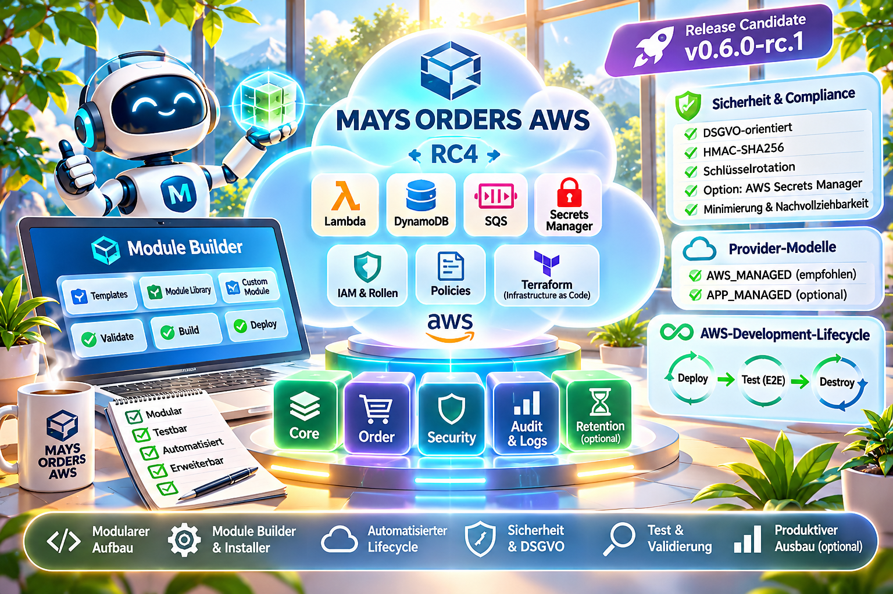
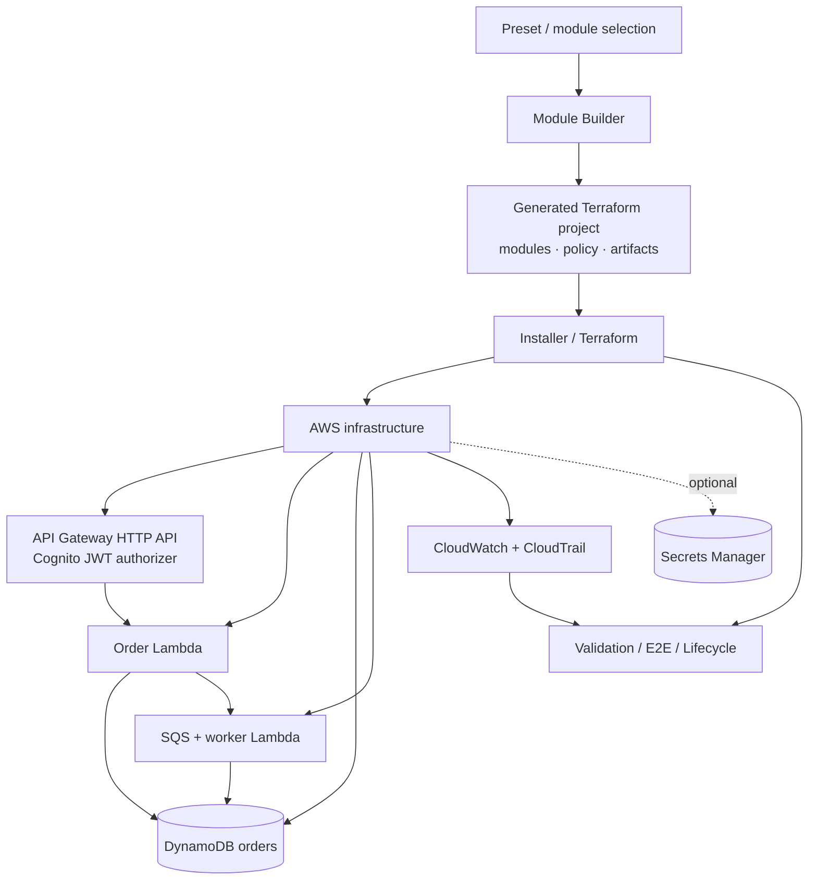

<p align="center">
  
</p>

<h1 align="center">Mays-Orders-AWS</h1>

<p align="center"><strong>Modular AWS Infrastructure Engineering</strong></p>

<p align="center">
  <em>Build modular. Secure by design. Verify the full lifecycle.</em>
</p>

<p align="center">
  <strong>Release:</strong> v0.6.0-rc.1 &nbsp;·&nbsp;
  <strong>Runtime:</strong> Python 3.14 &nbsp;·&nbsp;
  <strong>IaC:</strong> Terraform ≥ 1.5 &nbsp;·&nbsp;
  <strong>License:</strong> GPL-3.0
</p>

---

Mays-Orders-AWS is a modular serverless order-management stack for AWS. It combines a
library of Terraform modules, a deterministic **Module Builder**, and a guarded
**Installer** with a production-shaped order architecture on API Gateway, Lambda,
DynamoDB, SQS and Cognito.

The project is a **release candidate**, not a production rollout. Privacy-sensitive
activation, retention decisions and production operations remain separately gated.

## What Is Mays-Orders-AWS?

- **Modular by design.** Terraform components can be composed into a complete stack or
  reused as an `orders-service` module for another project.
- **Built to be generated.** The Module Builder creates a standalone Terraform project
  from the existing modules, policy gate, Lambda artifacts and seed tooling.
- **Operated through guardrails.** The Installer validates identity, project context,
  plans, policy and artifact state before any mutation.
- **AWS-based order architecture.** Cognito/JWT → API Gateway HTTP API → Lambda →
  DynamoDB, with SQS worker processing and operational observability.
- **Security-oriented configuration.** Exact-ARN IAM, opt-in Secrets Manager, optional
  APP_MANAGED HMAC keys, and no credentials or secret values in the repository.
- **Verified locally and in AWS Development.** Unit tests, policy checks, a real
  deploy/test/destroy lifecycle and reproducible artifacts are documented as historical
  evidence.

Mays-Orders-AWS is deliberately separate from Mays-RIS. Publishing this repository does
not update or deploy a RIS installation.

## Module Builder

The Module Builder is the primary composition tool. It copies tested Terraform modules,
root wiring, policy files and build artifacts into a target directory. The generated
project does **not** source code from this repository at runtime.

### Presets

| Preset | Purpose |
|---|---|
| `complete` | Full stack: API, Cognito, DynamoDB, Lambda, SQS + worker, recovery, monitoring, CloudTrail, optional Cognito backup and opt-in seed. |
| `orders-service` | Reusable seven-module Terraform contract: API, Cognito, DynamoDB, IAM, Lambda, SQS and worker. |
| `--modules ...` | Explicit module selection with fail-closed dependency checks; `--with-deps` adds required transitive modules. |

### Build a Standalone Stack

```bash
python3 -m module_builder presets

python3 -m module_builder build \
  --target ./generated/my-orders \
  --project-name my-orders \
  --preset complete \
  --validate
```

`--validate` runs `terraform fmt -check`, `terraform init -backend=false` and
`terraform validate` against the generated project. It does not contact AWS.

### Reusable Orders-Service Module

```bash
python3 -m module_builder build \
  --target ./modules/mays-orders-service \
  --project-name my-orders \
  --preset orders-service \
  --validate
```

### Custom Composition and Upgrades

```bash
python3 -m module_builder build \
  --target ./generated/custom \
  --project-name custom \
  --modules dynamodb,sqs,iam,lambda \
  --with-deps \
  --validate

python3 -m module_builder upgrade --project ./generated/my-orders --dry-run
python3 -m module_builder upgrade --project ./generated/my-orders --apply
```

The generated `module-builder.manifest.json` records file fingerprints and artifact
hashes. Upgrade classification distinguishes safe updates from user-owned or modified
files. Existing `*.tfvars`, `.env*` files and user changes are not overwritten.

### Deterministic Artifacts

- The Lambda ZIP is reproducible: **46,929 bytes** with SHA-256
  `20f4bab5766529e3340273cfde3b35c601a389122759051f2aef801337b76377`.
- The generated complete-project tree is deterministic apart from runtime manifest
  metadata.
- Artifact staleness and generated-project validation are checked before packaging.

## Installer

The Installer is a deployment lifecycle wrapper around Terraform. It does not replace
Terraform, IAM or human approval.

### Prerequisites

- Python 3
- Terraform ≥ 1.5
- AWS CLI with a named profile for AWS operations
- A reviewed target account, region, project name and Terraform workspace

AWS credentials stay outside the repository. The default mutation posture is safe:
`DRY_RUN=true` and `ALLOW_AWS_OPERATIONS=false`.

### Typical Local Flow

```bash
./Mays-Order-AWS-installer --help
./Mays-Order-AWS-installer --guide
./Mays-Order-AWS-installer validate
```

For a controlled remote plan, context must be explicit:

```bash
./Mays-Order-AWS-installer \
  --profile <aws-profile> \
  --region eu-central-1 \
  --project-name <project-name> \
  --environment development \
  plan --remote --out .mays-installer/runs/<run>/plans
```

### Guardrails

- Preflight validates AWS identity, account, region, project and Terraform context.
- `validate` includes a read-only AWS project-name collision scan when AWS context is
  available.
- Plans are bound to a manifest containing project, workspace, backend and source
  identity.
- The **Policy Gate** checks resource types, regions, tags and cost/safety rules before
  an apply.
- Deploy and destroy require a reviewed plan plus explicit mutation approval:
  `ALLOW_AWS_OPERATIONS=true`, `DRY_RUN=false`, `--yes` **and** human release.
- Destroy planning treats stateful resources specially; deleting data, buckets or
  Cognito resources is never treated as routine.

### Policy Gate

```bash
python3 terraform/policy/validate-plan.py <terraform-plan.json>
```

A FAIL is a stop signal. The gate complements IAM, budget controls and human review; it
does not replace them.

## Architecture



The root Terraform stack currently composes modules for API, Cognito, DynamoDB, IAM,
Lambda, SQS, worker, recovery, monitoring, CloudTrail, optional Cognito backup and
optional privacy-secret wiring. The `orders-service` preset is the smaller reusable
contract.

## Security & Privacy

| Area | Implemented behavior |
|---|---|
| User authentication | Cognito user pool and JWT via API Gateway HTTP API |
| AWS authorization | IAM roles and resource-scoped policies; no IAM access keys as user login |
| Secrets Manager | Optional, exact Secret ARN IAM; no secret values in Terraform |
| AWS_MANAGED | Optional Secrets Manager provider; AWS-managed encryption by default |
| APP_MANAGED | Optional HMAC key provider; **default-off** |
| HMAC | HMAC-SHA256 over a versioned, length-prefixed envelope; 32-byte keys |
| Rotation / revocation | One previous key in an explicit ≤24h window; fail-closed revocation; no automatic rotation |
| Auditability | CloudTrail, CloudWatch logs and secret-safe error logging |
| Least privilege | Exact ARNs and no wildcard Secrets/KMS permissions |
| Retention | **Intentionally disabled** until Q-05/Q-06/Q-07/Q-14 are approved |

Privacy inspect/export/erase capabilities exist behind the project’s internal trust
boundary. They are tested but not activated as a production privacy service.

**DSGVO-orientiert ist nicht DSGVO-konform.** The architecture supports data minimization,
limited access and controlled processing, but legal basis, retention periods, deletion
processes, processor agreements and operational controls still require owner/legal review.
No automatic retention or deletion is claimed.

## Testing & Validation

The following results are **historical RC4 evidence** from the tested release candidate,
not a statement that an AWS stack is currently running.

| Suite | Result |
|---|---:|
| Lambda unit tests | **440 PASS** |
| Installer tests | **674 PASS, 1 SKIP** |
| Module Builder tests | **129 PASS** |
| Policy Gate tests | **23 PASS** |
| Local E2E | **36 PASS, 5 SKIP** |
| Seed tests | **28 PASS** |
| AWS Live E2E | **4/4 PASS** |

AWS Development lifecycle evidence:

- **58 resources created**
- policy gate PASS
- live E2E passed with owner-verified cleanup
- **58 resources destroyed**
- Terraform state returned to **0 resources**
- temporary test identity removed

Terraform `fmt -check`, `init -backend=false` and `validate` pass. The test stack was
intentionally destroyed after verification.

## Release & Versioning

| Component | Version |
|---|---|
| RC4 Release Label | **v0.6.0-rc.1** |
| Module Builder | 0.1.0 |
| Installer | 0.1.0 |
| Deployment / Test Stack | 0.2.0 |

The annotated Git tag **`v0.6.0-rc.1`** points to commit
`5bc154e079b4d7ee9eedbbf5b45b1ecca5c35420`. This README and the PDF package are
post-tag documentation on `release/rc4-integration`; they are not part of the
tagged source tree. The main merge is prepared but not executed.

The release label is independent from component versions. Production activation, secret
provisioning, optional CMK policy, P00-F operational rotation and retention decisions
remain separate owner gates.

## Documentation

- [Release Notes](docs/RELEASE_NOTES.md)
- [Release PDF](docs/release/MAYS-ORDERS-AWS-v0.6.0-rc.1.pdf)
- [RC4 Module Release Candidate](docs/release/RC4-MODULE-RELEASE-CANDIDATE.md)
- [Architecture](docs/architecture/MAYS-ORDERS-ARCHITECTURE.md)
- [Installer Guide](docs/INSTALLER_GUIDE.md)
- [Installer Lifecycle](docs/INSTALLER-LIFECYCLE.md)
- [Terraform Policy Gate](docs/TERRAFORM_POLICY_GATE.md)
- [Product Overview](docs/PRODUCT_OVERVIEW.md)
- [Module Builder Foundation](docs/reports/MAYS-ORDERS-MODULE-BUILDER-FOUNDATION-01.md)
- [Module Builder Hardening](docs/reports/MAYS-ORDERS-MODULE-BUILDER-HARDENING-01.md)
- [Module Builder Options](docs/reports/MAYS-ORDERS-MODULE-BUILDER-OPTIONS-01.md)
- [Orders-Service Module Contract](docs/reports/MAYS-ORDERS-MODULE-CONTRACT-01.md)
- [Module Integration & Test Guide](docs/MAYS_ORDERS_TERRAFORM_MODUL_INTEGRATION_TEST_GUIDE_2026-10-19.md)
- [Security & Privacy Contract](docs/contracts/MO-RC4-P00-IMPLEMENTATION-CONTRACT.md)
- [APP_MANAGED HMAC Contract](docs/contracts/MO-RC4-P00-D-HMAC-PAYLOAD-CONTRACT.md)
- [RC4 Final Report](docs/reports/MO-RC4-FINAL-01.md)
- [AWS Development Lifecycle Report](docs/reports/MO-RC4-AWS-LIFECYCLE-FINAL-01.md)
- [RC4 Release Report](docs/reports/MO-RC4-RELEASE-01.md)

## License

This project is licensed under the **GNU General Public License v3.0 (GPL-3.0)**.
See [LICENSE](LICENSE) for the complete terms. No license change is made by this README.

---

<p align="center">
  <strong>Mays-Orders-AWS</strong> · Modular AWS infrastructure engineering<br>
  <sub>Release candidate · production activation separately gated</sub>
</p>
