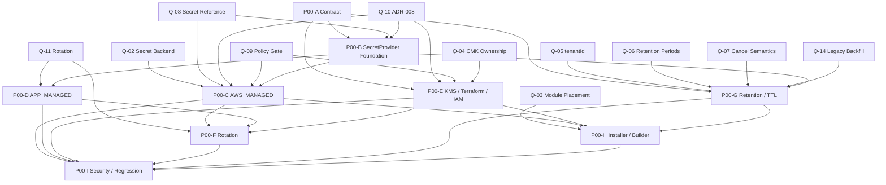

# MO-RC4-P00 Dependency Graph

**Status:** PLANNING ARTIFACT / OWNER APPROVAL PENDING
**Reference:** `docs/release/MO-RC4-P00-DECISION-REGISTER.md`
**Base:** `/home/dci-student/projects/Mays-Orders-AWS-rc4-integration` @ `release/rc4-integration`

> **Decision status 2026-11-13:** Q-02, Q-08 and Q-10 are DECIDED; ADR-008 is
> `ACCEPTED`. P00-B is **READY FOR AUTHORIZATION**; no implementation has
> started. P00-C/D/E/G remain separately gated.

---

## 1. Directed Graph



---

## 2. Edge Types

| Edge | Type | Consequence |
|---|---|---|
| Q-02 → P00-C | Owner + technical | C cannot start until backend is approved |
| Q-08 → P00-B/C | Owner + security | Reference/fetch shape must be fixed |
| Q-10 → P00-B/C/E | Governance | ADR-008 must be approved before service adoption |
| Q-09 → P00-C/E/H | Security/integration | Policy Gate must allow new resource shapes |
| Q-04 → P00-E | Security | CMK ownership model must be fixed |
| P00-B → P00-C/D | Technical | Shared provider interface |
| P00-C/E → P00-F | Technical/security | Rotation needs provider/key infrastructure |
| Q-05/Q-06/Q-07/Q-14 → P00-G | Owner/legal | Retention fields/semantics cannot be invented |
| P00-B/C/E/G → P00-H | Integration | Installer/Builder needs stable module contracts |
| P00-C/D/E/F/G/H → P00-I | Test/integration | Full security regression requires all packages |

---

## 3. Parallelization

### Safe parallel read-only work

- Architecture, Security, Privacy, Infrastructure, Compatibility and QA analyses.
- Provider design vs. KMS design (different files).
- Retention design vs. Terraform design (different concerns), provided no shared file edits.

### Parallel implementation candidates

| Workers | Files/areas | Condition |
|---|---|---|
| P00-B SecretProvider | `lambda/src/secret_provider.py`, privacy adapter | Q-08/Q-10 closed |
| P00-E KMS/Terraform/IAM | `terraform/modules/kms`, policy/IAM | Q-04/Q-09/Q-10 closed; separate branch |
| P00-G Retention | `order_types`, order service/validation | Q-05/Q-06/Q-07/Q-14 closed; after P00-B or rebase |

### Must be serialized

- P00-C and P00-D both touch the provider/secret adapter: sequence B → C → D
  unless file ownership is split and reviewed.
- P00-B and P00-G both touch `order_service.py`: do not merge in parallel.
- P00-F after C/D/E.
- P00-H after C/E/G.
- P00-I after all packages.

---

## 4. Security/Test Gates per Edge

| Package | Required gates before merge |
|---|---|
| P00-B | SG-01, SG-02, SG-06, SG-08 |
| P00-C | SG-01, SG-03, SG-06, SG-07, SG-08 |
| P00-D | SG-01, SG-02, SG-04, SG-08 |
| P00-E | SG-03, SG-06, SG-07, SG-08 |
| P00-F | SG-04, SG-07, SG-08 |
| P00-G | SG-02, SG-05, SG-06, SG-08 |
| P00-H | SG-03, SG-06, SG-07, SG-08 |
| P00-I | all SG-01…SG-08 |

---

## 5. Blocking Matrix

| Package | Blocks until |
|---|---|
| P00-B | Q-08, Q-10 |
| P00-C | P00-B, Q-02, Q-08, Q-09, Q-10 |
| P00-D | P00-B, Q-10, Q-11 |
| P00-E | Q-04, Q-09, Q-10 |
| P00-F | P00-C/D/E, Q-11 |
| P00-G | Q-05, Q-06, Q-07, Q-14; P00-B serialization |
| P00-H | P00-C, P00-E, P00-G, Q-03, Q-08, Q-09 |
| P00-I | all implemented packages, Q-12, Q-13 |

---

## 6. Integration Order

```text
1. P00-B   SecretProvider foundation (env default unchanged)
2. P00-E   KMS/terraform/IAM (can overlap B on separate branch)
3. P00-C   AWS_MANAGED/Secrets Manager
4. P00-D   APP_MANAGED/HMAC
5. P00-F   Rotation
6. P00-G   Retention/TTL (after B; order model)
7. P00-H   Installer/Builder
8. P00-I   Security/regression/release gates
```

Each step: feature branch from the current approved `release/rc4-integration`
HEAD, rebase/review, tests, security gates, auditlog, then one controlled
integration commit.

---

## 7. Open Dependency Risks

- Q-06 external legal decision may leave P00-G design-ready but implementation
  blocked.
- Q-09 gate extension is a security-sensitive change; it blocks Terraform
  applicability, not local design.
- P00-E can create Terraform shapes that the existing Policy Gate rejects until
  Q-09 is implemented.
- P00-D and P00-C share provider code; parallel editing would create avoidable
  conflicts.
- P00-G and P00-B both touch order service; parallel merges are unsafe.

**No implementation starts from this graph without Owner approval.**
