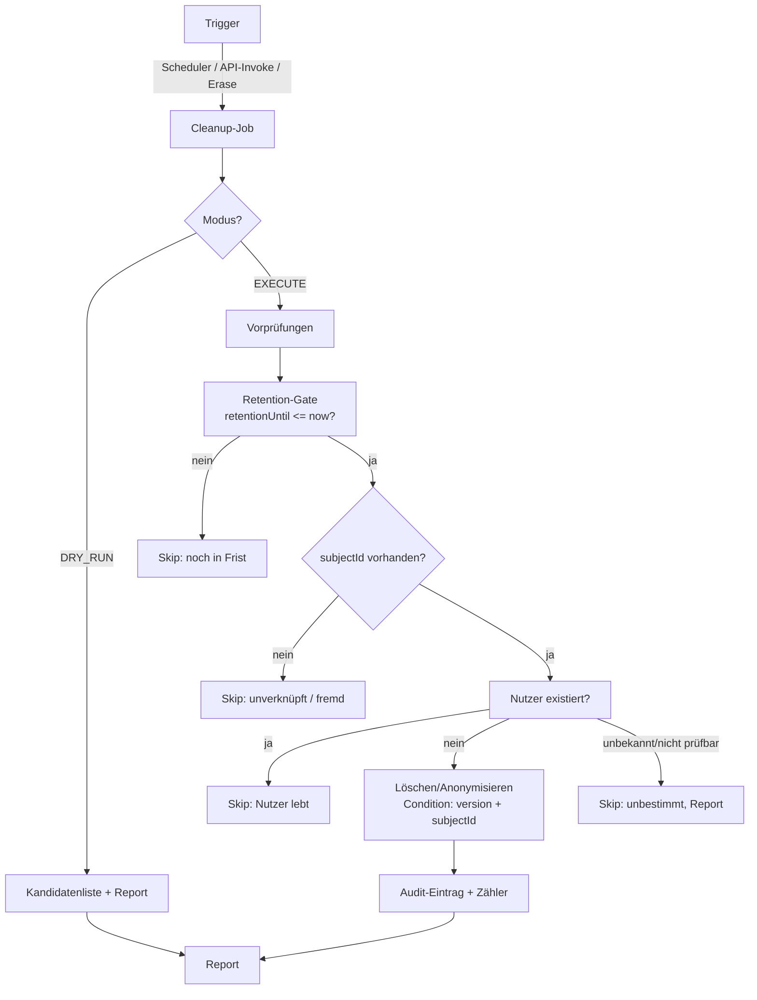

# MO-RC4-P01-ORPHAN-CLEANUP-DESIGN

**Architekturvorschlag: Verwaiste Datensätze erkennen und sicher bereinigen**

**Datum:** 2026-11-01
**Typ:** Design (keine Implementierung)
**Vorbedingung:** `MO-RC4-P01-CONTRACT-INVENTORY.md` (Ist-Verträge)

---

## 1. Problem

Heute gilt (belegt, siehe Inventory §2–§3):

- Bestellungen haben **keinen** Nutzerbezug im API-Pfad (`subjectId` wird nie gesetzt).
- Es gibt **keine** Retention-Frist und **keine** automatische Bereinigung.
- Wird ein Nutzer gelöscht, bleiben Bestellungen unverändert bestehen.
- Das Erase-Werkzeug findet nur GSI2-Items → bei API-Orders **nichts**.
- RIS schreibt Bestellungen **direkt** in die Tabelle (ohne `subjectId`, teils mit
  `pk`-Muster `ord_ord_…`).

**Ziel:** Eine wiederholbare, idempotente Routine, die verwaiste Datensätze erkennt,
Fristen respektiert, nur Zulässiges löscht und fremde Daten nie anfasst.

## 2. Definition „verwaist“ (bewusst eng)

> **Verwaist** = eine Bestellung, deren zugeordneter Nutzer nachweislich nicht mehr
> existiert **und** deren Aufbewahrungsfrist abgelaufen ist **und** die nicht durch eine
> Aufbewahrungspflicht (`RETAIN`) geschützt ist.

Daraus folgen drei harte Regeln:

1. **Bestellungen ohne Nutzerbezug sind NICHT verwaist.** Sie sind „unverknüpft“
   (heutiger Normalfall!) und dürfen **nicht** gelöscht werden. Ohne Nutzerbezug gibt es
   keinen Beweis, dass der zugehörige Nutzer gelöscht wurde.
2. **Nicht prüfbare Zuordnung ⇒ keine Löschung.** Wenn Cognito nicht erreichbar ist
   oder MO keinen Zugriff auf den Pool hat (EXTERNAL), lautet das Ergebnis „unbekannt“,
   nicht „gelöscht“ (fail-closed).
3. **Fremde Schreibpfade** (RIS-`orders_reader`, manuelle Imports) erzeugen Bestellungen,
   die MO nicht als „verwaist“ einstufen darf, solange sie nicht ausdrücklich als
   MO-verwaltet markiert sind.

**Konsequenz:** Die Routine arbeitet nur auf Datensätzen, die (a) einen `subjectId`
besitzen **oder** (b) durch ein künftiges Provenienz-Feld als MO-verwaltet markiert sind.

## 3. Bewertung der Auslöser

| Auslöser | Bestehende Infrastruktur | Zusätzliche AWS-Ressourcen | Berechtigungen | Kosten | Ausfallsicherheit | Sicherheitsrisiko | Testbarkeit |
|---|---|---|---|---|---|---|---|
| **Benutzerlöschereignis** (Cognito-Trigger) | keine (kein Trigger, kein Stream) | Lambda-Permission am Pool oder Cognito-User-Pool-Trigger; ggf. EventBridge | `lambda:InvokeFunction` für Cognito | minimal | **hoch** (Trigger kann fehlen/verpasst werden) | mittel (Trigger muss authentifiziert/validiert werden) | gut (Event-Fixtures) |
| **Privacy-Erase-Auftrag** (bestehend) | `privacy/erase` implementiert, interner Invoke | keine | bestehende `lambda:InvokeFunction`-Freigabe | minimal | mittel (manuell ausgelöst) | niedrig (fail-closed, Auth-Boundary) | **sehr gut** (Unit + Fake-DB) |
| **Geplanter Prüflauf** (Scheduler) | Cognito-Backup nutzt bereits EventBridge/Scheduler-Muster | Scheduler-Regel + Cleanup-Lambda (oder Reuse Handler mit `internalAction`) | `dynamodb:Scan/Query`, `cognito-idp:ListUsers` (nur MANAGED) | gering (1 Lauf/Tag) | **hoch** (nachholbar, idempotent) | mittel (Massenlöschung → Dry-Run + Limits) | **sehr gut** (Batch-Invarianten) |
| **API-Aufruf des Consumers** (expliziter Cleanup) | keine Route; interne Invoke-Mechanik vorhanden | keine | bestehende Invoke-Freigabe | minimal | hoch | mittel (Missbrauch → Berechtigungsprüfung nötig) | sehr gut |
| **DynamoDB TTL** | kein TTL-Block vorhanden | TTL-Attribut an der Tabelle | keine zusätzlichen | minimal | **niedrig für Nachweis** (Löschung asynchron, bis 48 h Verzug, kein Audit) | niedrig | schlecht (nicht deterministisch prüfbar) |

### 3.1 Bewertung im Klartext

- **TTL ist kein Lösch-Nachweis.** Sie ist eine *Ergänzung* für zeitbasierte Fristen,
  kein Ersatz für einen prüfbaren Cleanup (Verzug, keine Rückmeldung, kein Audit).
- **Eventbasierter Cleanup ist unvollständig**: Cognito-Trigger existieren nicht, und für
  EXTERNAL-Pools hätte MO keinen zuverlässigen Trigger.
- **Der periodische Prüflauf ist der robusteste Kern**: nachholbar, idempotent, testbar,
  ohne Annahme über Event-Zustellung. Er ist die **empfohlene primäre** Mechanik.
- **Der bestehende Privacy-Erase-Auftrag bleibt der punktuelle Weg** (Nutzeranfrage mit
  sofortiger Wirkung) und sollte um Retention-Fristen erweitert werden.

## 4. Zielarchitektur (Vorschlag)

### 4.1 Komponenten

| Komponente | Aufgabe | Wiederverwendung |
|---|---|---|
| **Cleanup-Orchestrator** | Batch-Verarbeitung, Seitengrenzen, Dry-Run, Zähler | neuer Handler im bestehenden ZIP-Paket oder eigenes Bundle |
| **Kandidaten-Query** | GSI2-Scan/Query bzw. gefilterter Scan auf `retentionUntil <= now` | GSI2 existiert; für Fristen ist ein **neuer GSI3** (`retentionUntil`) oder ein gefilterter Scan nötig (Q-04) |
| **Nutzer-Existenzprüfung** | MANAGED: `ListUsers`/`AdminGetUser`; EXTERNAL: **nicht möglich** → „unbestimmt“ | `cognito_backup/exporter.py`-Muster |
| **Retention-Gate** | vergleicht `retentionUntil` mit `now`; `RETAIN`-Marker gewinnt immer | neues Feld |
| **Lösch-/Anonymisierungs-Executor** | `delete_item`/`update_item` mit `ConditionExpression` (`subjectId`, `version`) | `erase_subject` (Logik übernehmen) |
| **Audit-Writer** | Ergebnis pro Datensatz (ohne PII) | neu; CloudWatch-Log + optional Audit-Item |

### 4.2 Datenmodell-Erweiterungen (Vorschlag, **nicht** implementiert)

| Feld | Typ | Zweck | Default |
|---|---|---|---|
| `retentionUntil` | ISO-8601 (`S`) | fachliche Frist | aus Policy/Variable; Bestand: **nicht gesetzt** |
| `ttl` | Number (Epoch) | TTL-Beschleuniger (optional) | abgeleitet aus `retentionUntil` |
| `subjectId` | String | Nutzerbezug | **muss künftig beim Anlegen gesetzt werden** |
| `retentionPolicy` | String (`ERASE`/`ANONYMIZE`/`RETAIN`) | Entscheidung pro Bestellung | Policy-Default |
| `dataProvenance` (optional) | String (`MO_API`/`RIS_WRITER`/`SEED`) | Schutz fremder Daten | `UNKNOWN` bei Bestand |

> **Wichtig:** Keine dieser Erweiterungen ist ein API-Pflichtfeld. Alle bleiben intern oder
> optional (siehe `MO-RC4-P01-OPEN-QUESTIONS.md`, Q-02/Q-05).

### 4.3 Idempotenz und Wiederaufnahme

1. **Kein Zustandsautomat mit Zwischenspeicher:** jede Verarbeitung ist
   „lesen → prüfen → bedingt schreiben“; ein Wiederholungslauf erzielt dasselbe Ergebnis.
2. **Bedingte Schreiboperationen** (`ConditionExpression` auf `subjectId` + `version`)
   verhindern das Löschen zwischenzeitlich geänderter Datensätze.
3. **Batch-Grenzen + Fortsetzungsmarke** (`LastEvaluatedKey`) verhindern Timeouts; ein
   abgebrochener Lauf wird beim nächsten Termin fortgesetzt (kein Fortschrittsverlust).
4. **Zähler-Report** je Lauf (`scanned`, `skipped_*`, `deleted`, `anonymized`, `failed`)
   erlaubt Soll/Ist-Vergleich und Alarmierung.
5. **Fehler pro Datensatz** werden gezählt, nicht als Lauf-Abbruch behandelt (bis zu einer
   Fehlerschwelle, danach Abbruch mit Report).

### 4.4 Sicherheitsregeln (nicht verhandelbar)

- **Dry-Run ist der Default.** `EXECUTE` erfordert explizite Freigabe (Flag + Aufrufer).
- **Nur MO-verwaltete Daten**: `subjectId` vorhanden **oder** `dataProvenance == MO_API`.
- **Retention gewinnt**: `RETAIN`, nicht abgelaufene Frist, fehlende Frist ⇒ kein Löschen.
- **Kein Cross-Tenant/-Projekt**: Projektname/`ORDERS_PROJECT_NAME` wird geprüft
  (Muster `_require_privacy_auth`), Tabellenname fest gebunden.
- **Keine Cognito-Mutation** durch den Cleanup (nur lesen).
- **Kein Secret/PII im Log**; Audit enthält nur `pk`, Aktion, Grund, Zeit.
- **Limit pro Lauf** (z. B. 500 Datensätze), um Massenlöschung durch Fehlkonfiguration
  zu begrenzen; Überschreitung → Report + Alarm, kein Weiterlauf.

## 5. Auslöser-Entscheidung (Empfehlung)

| Phase | Mechanik | Begründung |
|---|---|---|
| RC4 | **Dry-Run-fähiger periodischer Prüflauf** (Scheduler) + bestehender Privacy-Erase | nachholbar, testbar, keine Event-Abhängigkeit |
| RC4 (optional) | TTL als **Beschleuniger** zusätzlich, nie als Nachweis | einfache Fristdurchsetzung |
| RC5 | Eventbasierter Trigger (Cognito/EventBridge), falls MANAGED-Pool und Bedarf | schnellere Reaktion, aber neue AWS-Ressource + ADR |

**Nicht empfohlen für RC4:** rein eventbasierter Cleanup (Trigger fehlen, EXTERNAL-Pools
nicht abgedeckt) und TTL-only (kein Nachweis, kein Audit).

## 6. Risiken und Gegenmaßnahmen

| Risiko | Gegenmaßnahme |
|---|---|
| Löschung fremder (RIS-)Bestellungen | Provenienz-Regel + `subjectId`-Pflicht als Kriterium; Dry-Run-Report zur Sichtprüfung |
| Massenlöschung durch Fehlkonfiguration | Limit/Lauf, Dry-Run-Default, Freigabe-Flag, Alarm bei Schwelle |
| Frist falsch berechnet (Zeitzone) | ausschließlich UTC-ISO bzw. Epoch; Unit-Tests mit Grenzfällen |
| Cognito nicht erreichbar | Status „unbestimmt“ → kein Löschen (fail-closed) |
| EXTERNAL-Pool ohne ListUsers | explizit „nicht prüfbar“ → kein Löschen; Consumer muss löschen/beauftragen |
| Race mit Nutzer-Aktivität | Condition auf `version`/`subjectId` |
| TTL löscht vor Frist (Fehlberechnung) | TTL nur aus `retentionUntil` ableiten; niemals manuell setzen |
| Fehlender Audit-Trail | Audit-Item/Log pro Aktion + Lauf-Report |

## 7. Teststrategie

| Ebene | Test |
|---|---|
| Unit | Frist-/TTL-Berechnung, Dry-Run ohne Mutation, Skip-Gründe, Limit, Fehlerzähler |
| Contract | Fremde Felder weiterhin abgelehnt; Response-Format unverändert |
| Integration (Fake-DB) | „abgelaufen + Nutzer weg“ → löschen; „abgelaufen + Nutzer da“ → skip; „kein subjectId“ → skip; `RETAIN` → skip; unbeantwortbares Cognito → skip |
| Idempotenz | zweimaliger Lauf ⇒ gleiche Zähler, keine Doppel-Löschung, keine Fehler |
| Wiederaufnahme | Abbruch nach N Datensätzen, Fortsetzung mit `LastEvaluatedKey` |
| Sicherheit | Log-Assertion ohne PII/Secret; ConditionExpression vorhanden |
| Regression | 76 Lambda + 90 Builder + 81 Installer unverändert grün |

## 8. Akzeptanzkriterien (Design)

- [x] Definition „verwaist“ eng gefasst und begründet.
- [x] Alle fünf Auslöser bewertet (Infrastruktur, Rechte, Kosten, Ausfall, Sicherheit, Test).
- [x] TTL ausdrücklich **nicht** als Lösch-Nachweis akzeptiert.
- [x] Fremddaten-Schutz (RIS) explizit geregelt.
- [x] Idempotenz, Fehlerbehandlung und Abbruchverhalten beschrieben.
- [x] Keine Implementierung, keine neuen Pflichtfelder, keine AWS-Ressource angelegt.
