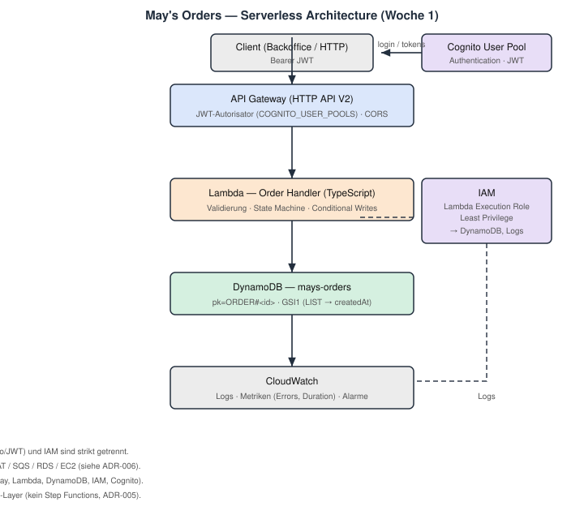
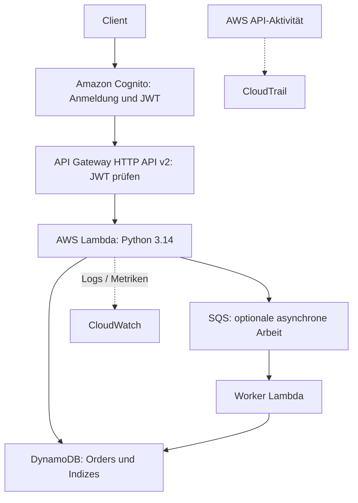
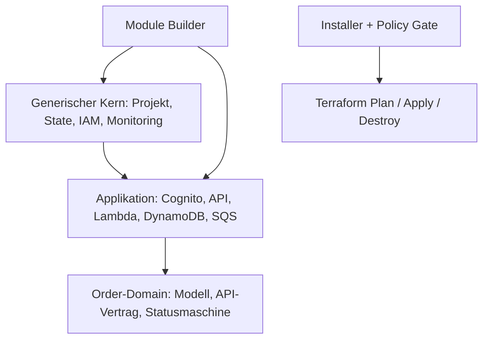

# 02 · Architektur

> **Kurz erklärt:** Ein Client meldet sich an, schickt eine Bestellung an eine
> API; ein Cloud-Dienst speichert sie und kann sie im Hintergrund
> weiterverarbeiten. Terraform beschreibt diese Bausteine.

> Das frühe Repository-Diagramm unter `architecture/architecture-diagram.svg`
> trägt den Stand „Woche 1“. Für den aktuellen RC4-Aufbau ist die folgende
> Systemübersicht aus den aktuellen Release- und Architekturquellen abgeleitet;
> die alte Abbildung ist deshalb nicht als vollständige aktuelle Stückliste zu
> verstehen.

*Abbildung: frühes Repository-Diagramm; maßgeblich für den aktuellen Stand sind
die Tabellen und Mermaid-Diagramme dieser Seite sowie `architecture/` und
`terraform/`.*

## Der Weg eines API-Aufrufs

Die Darstellung beschreibt den konzeptionellen RC4-Order-Kern. Der genaue
Ressourcenumfang hängt von Modulwahl und Konfiguration ab. Ein optionales
Modul ist nicht automatisch bei jeder Installation eingeschaltet.

## Aufgaben der Komponenten

| Komponente | Verantwortung |
|---|---|
| Cognito User Pool | Anmeldung und Ausgabe von Benutzer-JWTs |
| API Gateway HTTP API | Exponiert Routen; prüft JWT-Signatur und Claims vor dem Handler |
| Order-Lambda | Validierung, Objektzugriff, Domainregeln und Datenoperationen |
| DynamoDB | Order-Datensätze und indizierte Zugriffsmuster; kein Full-Table-Scan als reguläres Listing |
| SQS / Worker | Entkoppelte Verarbeitung mit kontrollierten Wiederholungs- und Fehlerpfaden |
| IAM | Rechte zwischen AWS-Diensten nach Least Privilege; keine Benutzeranmeldung |
| CloudWatch / CloudTrail | Laufzeitbeobachtung und AWS-Aktivitätsnachweise |
| Terraform | Deklarative Infrastruktur und Module |
| Installer | Kontext-, Plan-, Policy- und Artefaktprüfungen rund um Terraform |

## Identität ist nicht dasselbe wie Berechtigung

Cognito beantwortet: **Wer ruft die API auf?** Das JWT enthält eine Identität,
die für Objekt- und Consumer-Prüfungen verwendet wird. IAM beantwortet:
**Welche AWS-Aktion darf ein Dienst ausführen?** Zum Beispiel erhält eine
Lambda-Rolle nur die DynamoDB- oder SQS-Aktionen, die sie für ihren Zweck
benötigt. IAM-Access-Keys sind kein Benutzer-Login.

Die Order-Daten trennen Aufrufer-/Eigentümerkontext und fachlichen Order-Typ.
`orderType` routet Verarbeitung; es ersetzt keine Autorisierung.

## Modulschichten

Die Installationskonfiguration löst Projektname, Workspace, Region und
Umgebung auf. Backend und State-Key müssen zu genau diesem Kontext passen. Ein
Terraform-Workspace ist eine logische State-Auswahl; er ist weder eine
Zugriffsgrenze noch ein Ersatz für getrennte AWS-Konten.

### Terraform-Struktur

Das Root-Modul orchestriert sieben Child-Module:

| Modul | Aufgabe |
|---|---|
| `dynamodb` | Orders-Tabelle, GSIs, PITR |
| `iam` | Least-Privilege-Rollen und -Policies |
| `lambda` | Handler-/Worker-Funktionen und Artefakt |
| `cognito` | User Pool, Client, JWT-Kontext |
| `api` | HTTP API v2, Routen, JWT-Autorisierer |
| `monitoring` | CloudWatch-Logs/-Alarme |
| `cloudtrail` | Management-Event-Audit |

Das Backend liegt in S3 mit DynamoDB-Lock; `bootstrap/` provisioniert die
State-Infrastruktur. Das Policy Gate (`terraform/policy/validate-plan.py`)
prüft Pläne vor einer Mutation.

## Bewusste Architekturentscheidungen

- Serverless statt dauerhaft betriebener EC2-/Container-Flotte.
- HTTP API v2 mit JWT-Autorisierung.
- DynamoDB-Zugriff über definierte Schlüssel/Indizes.
- SQS nur für tatsächlich asynchrone Verarbeitung.
- Keine neuen AWS-Dienste ohne begründete Architecture Decision.
- Generierte Projekte sind eigenständige Outputs; sie laden nicht zur Laufzeit
  Module aus dem Quellrepository.

### Weiterführende Quellen

- `architecture/architecture-and-security.md`
- `architecture/architecture-decisions.md`
- `architecture/request-flow.md`
- `architecture/networking.md`
- `docs/architecture/MAYS-ORDERS-ARCHITECTURE.md`
- `docs/architecture/MAYS-ORDERS-BACKEND-STATE.md`
