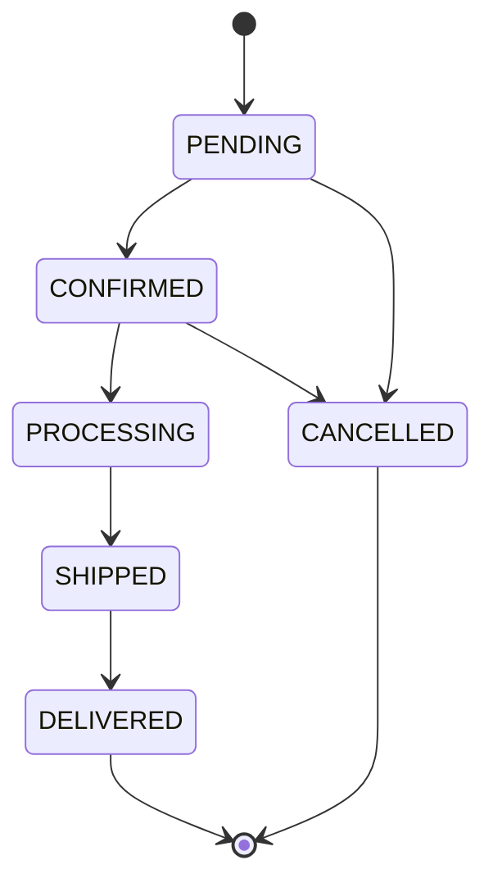

# 03 · Orders und API

> **Kurz erklärt:** Eine Order ist ein Datensatz mit Kunde, Positionen und
> Status. Die API erlaubt Anlegen, Lesen und erlaubte Statuswechsel; ungültige
> oder fremde Zugriffe werden abgelehnt.

## Die Order in Alltagssprache

Eine Order beginnt als **PENDING**. Je nach Status und Geschäftsregel kann sie
bestätigt, verarbeitet, versandt oder zugestellt werden. Ungültige oder
veraltete Änderungen werden abgelehnt. DynamoDB Conditional Updates schützen
davor, dass zwei gleichzeitige Änderungen unbemerkt denselben alten Zustand
überschreiben.



Das Diagramm zeigt den normalen Pfad und Cancellation-Zustände, nicht jede
technische Nebenbedingung. Für die vollständige, maßgebliche Übergangstabelle
ist der Code in `order-lifecycle/` sowie die RC4-Statusmaschine maßgeblich.

## API-Routen

| Methode | Pfad | Aufgabe |
|---|---|---|
| `POST` | `/orders` | neue Order anlegen |
| `GET` | `/orders/{orderId}` | eine Order abrufen |
| `GET` | `/orders` | paginierte Liste lesen |
| `PATCH` | `/orders/{orderId}/status` | erlaubte Statusänderung anfordern |

Alle beschriebenen API-Routen erfordern ein Cognito-JWT. Der öffentliche
API-Vertrag steht in [`api/endpoints.md`](../../api/endpoints.md); konkrete
Fehlercodes, Header und Antwortfelder dort prüfen.

## Eine Order anlegen

Ein Request enthält Kunde, mindestens eine Position, Währung und optional
`orderType` sowie `orderDescription`:

```json
{
  "customer": { "name": "Max Beispiel", "email": "max@example.test" },
  "items": [{ "sku": "SKU-1001", "quantity": 2, "unitPrice": 20 }],
  "currency": "EUR",
  "orderType": "generic",
  "orderDescription": "Beispielbestellung"
}
```

`orderType` ist ein maschinenlesbarer Verarbeitungs-/Routinghinweis; unbekannte
Typen werden nicht still als `generic` verarbeitet. `orderDescription` ist
lesbarer Freitext (bis 1.024 Zeichen nach Trimmen). Weil Freitext
personenbezogene Daten enthalten kann, wird er bei Privacy-Inspect, Export und
Anonymisierung berücksichtigt. Er ist nicht Teil der kompakten `GET /orders`
Projektion.

### Positionen (`items`)

`items` ist Pflicht und enthält mindestens ein Objekt mit genau diesen Feldern:

| Feld | Typ | Regel |
|---|---|---|
| `sku` | String | nicht leer; **kein** Katalog-/Existenzcheck; Wert wird nicht getrimmt |
| `quantity` | Integer | ≥ 1; keine Floats, Strings oder Booleans |
| `unitPrice` | Integer | ≥ 1; keine Nachkommastellen, keine 0/negativen Werte |

Der Server ergänzt `lineTotal = quantity × unitPrice` und berechnet
`totalAmount` als Summe. Zusätzliche Item-Felder (z. B. `lineTotal`, `name`,
`currency`) werden mit **400** abgelehnt. Es gibt kein fachliches Maximum für
Anzahl oder Menge; praktisch begrenzen Request-Größe und das DynamoDB-Item-Limit
von 400 KB.

`sku` ist ein freier String. Eigene Konventionen (z. B. ein interner
Order-Art-Marker) sind möglich, aber **nicht normativ** und kein Ersatz für
`orderType`. Details und ein Beispiel stehen in `api/endpoints.md` §2.1.1.

### Typische Fehler

| HTTP | Code | Bedeutung |
|---|---|---|
| 400 | `VALIDATION_ERROR` | ungültiger Body, Feld, Status-String oder `orderId` |
| 401 | `UNAUTHORIZED` | fehlende/ungültige JWT-Identität |
| 404 | `ORDER_NOT_FOUND` | Order fehlt, fremd oder Legacy ohne vollständige Identität |
| 409 | `INVALID_TRANSITION` | Statuswechsel laut Matrix nicht erlaubt |
| 409 | `CONFLICTED_UPDATE` | paralleles Update hat gewonnen; neuer Lesevorgang nötig |

Die Beispielwerte sind Dokumentationsdaten, keine echten Kundendaten. Bitte
keine Tokens, Geheimnisse oder unnötigen personenbezogenen Daten in Freitext
schreiben.

## Ownership und Consumer-Isolation

Der authentifizierte Nutzer-/Consumer-Kontext ist Teil der Zugriffskontrolle.
Eine gültige JWT-Authentifizierung allein gewährt nicht automatisch Zugriff auf
jede Order. RIS als Consumer ist zudem nicht mit `orderType` identisch; es gilt
ein separater Integrations- und Release-Pin.

## Asynchrone Verarbeitung

Wenn eine Order-Variante eine asynchrone Verarbeitung benötigt, legt die API
eine Nachricht in SQS ab. Ein Worker verarbeitet diese und aktualisiert den
Order-Zustand unter kontrollierten Bedingungen. Fehlgeschlagene Nachrichten
können über DLQ/Redrive untersucht werden. Der genaue Status- und
Wiederherstellungsprozess steht in `docs/runbooks/` und den RC4-P02-Berichten.

Der RC4-Release dokumentiert Worker-seitige Idempotenz und Conditional Updates.
Ein dokumentierter HTTP-`Idempotency-Key` für Client-Retries ist **kein** Teil
des RC4-Vertrags.

## Bekannte Integrationsgrenzen

- Der freigegebene produktive Handler im RC4-Scope ist `generic`; weitere
  Handler sind nicht als produktiv verifiziert ausgewiesen.
- Legacy-Orders ohne passende Identität bleiben im RC4-Kandidaten nicht
  zugreifbar (`404`); eine Bestandsmigration wurde nicht Bestandteil dieses
  Kandidaten.
- Das nach dem Release integrierte Feld `orderDescription` ist in `main`, aber
  bis zu einem getrennt freigegebenen Deployment nicht als live verfügbar
  vorauszusetzen.

### Quellen

- `api/endpoints.md`, `api/test-cases.md`, `api/api-documentation.md`
- `order-lifecycle/`
- `database/` und `docs/diagnostics/dynamodb/`
- `docs/reports/MO-RC4-P02-*.md` sowie `MO-ORDER-DESCRIPTION-*.md`
