# 05 · Installer

> **Kurz erklärt:** Der Installer ist der Sicherheitsgurt um Terraform: Er prüft
> Konto, Projekt, Plan und Artefakte, bevor jemand „apply“ sagt — und er
> ersetzt weder Terraform noch die menschliche Freigabe.

## Zweck

Der Installer begleitet den Terraform-Lebenszyklus. Er prüft, ob AWS-Identität,
Projekt, Workspace, Backend, Plan, Artefakte und Freigaben zusammenpassen. Er
ist eine zusätzliche Schutz- und Bedienebene; er ersetzt keine IAM-Rechte,
keine Prüfung durch Menschen und nicht Terraform.

## Sicherer Ablauf

```mermaid
flowchart LR
  Context["Identität, Konto, Region, Projekt, Workspace"] --> Scan["Collision- und State-Preflight"]
  Scan --> Plan["Plan + Artefaktprüfung"]
  Plan --> Policy["Policy Gate + Kontextbindung"]
  Policy --> Approve["Freigabe genau dieses Plans"]
  Approve --> Apply["Deploy / Apply"]
  Apply --> Verify["Smoke-, E2E- und Evidence-Prüfung"]
  Verify --> DestroyPlan["separater Destroy-Plan und Safety Gate"]
  DestroyPlan --> Destroy["Rückbau + State-/AWS-Nachprüfung"]
```



Bei jedem Schritt gilt: Konto, Region, Projektname, Workspace, Backend und
Planidentität bewusst gegenprüfen. Ein Plan ist keine Freigabe. Ein
Terraform-Plan kann Remote-Backend-Metadaten lesen und lokale Dateien erzeugen;
„read-only“ bedeutet nicht „ohne Nebenwirkungen am lokalen Rechner“.

## Einstieg

```bash
./Mays-Order-AWS-installer --help
./Mays-Order-AWS-installer --guide
./Mays-Order-AWS-installer identity
./Mays-Order-AWS-installer validate
./Mays-Order-AWS-installer plan
```

| Befehl | Zweck | Mutation? |
|---|---|---|
| `validate` | Vorprüfungen/Kontext | nein (kann AWS/Terraform lesen) |
| `plan` | Terraform-Plan erzeugen | nein (kann Remote-Backend lesen) |
| `plan-destroy` | separaten Destroy-Plan erzeugen | nein |
| `deploy` | exakt gespeicherten Plan anwenden | **ja — Freigabe nötig** |
| `destroy` | exakt gespeicherten Destroy-Plan anwenden | **ja — Freigabe nötig** |
| `backup` | DynamoDB-Backup planen/erstellen | plan: nein; create: AWS-Aktion |
| `state` | Terraform-State verwalten | je nach Unterbefehl |
| `output` | Outputs anzeigen | nein |
| `identity` | AWS-Identität anzeigen | nein |
| `gui` | read-only Shell-GUI | nein |

Die Syntax des ausgerollten Installer-Standes mit `--help` prüfen. `--guide`
zeigt den installierten Guide-Pfad und das Inhaltsverzeichnis. Die Optionen
`validate`, `identity`, `plan` und `output` können je nach Konfiguration AWS
oder Terraform kontaktieren; sie sind nicht pauschal Offline-Kommandos.

## Mutationen und Rückbau

`deploy`/`apply` und `destroy` sind AWS-Mutationen. Sie erfordern im Projekt
explizite menschliche Freigabe und ein exakt gebundenes Plan-/Kontextpaket. Ein
FAIL im Policy Gate wird nicht umgangen. Destroy wird separat geplant und
geprüft; nach dem Rückbau State und AWS-Ressourcen kontrollieren. Keine
Handbuchseite ersetzt die Freigabe für einen konkreten Einsatz.

## Namenskollisionen

Der read-only `aws_project_collision`-Preflight sucht nach
Namensduplikaten/Projekt-Treffern und kann Warnungen melden. Ein Treffer
beweist nicht, wem eine Ressource gehört; ein gleiches Tag oder ein ähnlicher
Name ist kein Ownership-Nachweis. State, Account, Workspace und tatsächliche
Ressourcenidentität zusammen prüfen. Nicht zugeordnete Ressourcen nicht
automatisch löschen.

## Hilfe bei Fehlern

- Fehlt AWS-Kontext: zuerst Profil und `aws sts get-caller-identity` prüfen.
- Falscher Workspace oder State-Key: anhalten, korrekten Projektkontext
  bestimmen; nicht mit einem anderen State „weiterprobieren“.
- Plan ändert unerwartete Ressourcen: stoppen und Ownership/Drift analysieren.
- Artefakt-Hash weicht ab: nichts deployen; Build/Manifest/Quelle vergleichen.
- Policy Gate FAIL: Ursache bearbeiten und neuen Plan erzeugen.
- Destroy-Plan enthält fremde/unbekannte Ressourcen: abbrechen und State
  forensisch aufklären.

## Was der Installer nicht ist

- Kein Ersatz für Terraform, IAM, AWS-Organisation oder Betriebsfreigaben.
- Kein automatischer Produktionsdeployer; `deploy`/`destroy` bleiben
  menschlich freizugeben.
- Kein Nachweis, dass ein Plan korrekt, kostengünstig oder genehmigt ist.
- Kein Berechtigungsmodell: IAM-Rollen und Least Privilege bleiben getrennt.

### Quellen

- `docs/INSTALLER_GUIDE.md`, `docs/INSTALLER-LIFECYCLE.md`
- `installer/cli/` und `installer/core/`
- `docs/reports/MAYS-ORDERS-INSTALLER-COLLISION-PREFLIGHT-01.md`
- `docs/reports/MO-INSTALLER-UPGRADE-*.md`
- `docs/TERRAFORM_POLICY_GATE.md`
- [Dokumentationsportal](11-dokumentationsportal.md)
