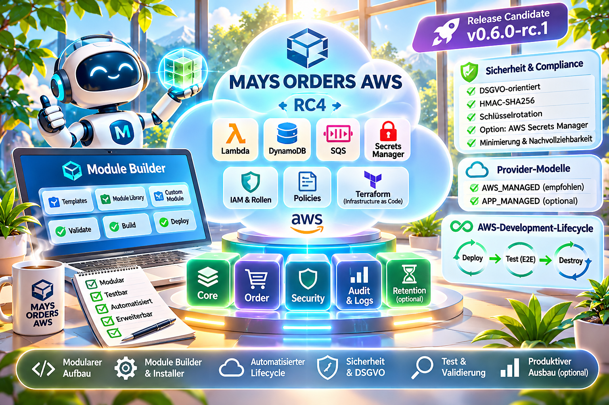

# 07 · Betrieb und Release

## Release-Stand

| Thema | Dokumentierter Status am 25.11.2026 |
|---|---|
| Release-Kandidat | `v0.6.0-rc.1`, als GitHub-Pre-Release veröffentlicht |
| Versioniertes RC4-Testmodul | RC4 Order-Kern im abgegrenzten Modulscope |
| AWS-Development-Lifecycle | 58 Create, 4/4 Live-E2E, 58 Destroy, State 0; historischer Development-Nachweis |
| Produktion | Nicht deployed, nicht freigegeben |
| Retention/automatische Löschung | deaktiviert; Fristen/Entscheidungen offen |
| RIS-Consumer | RC4-Consumer-Abnahme nicht enthalten; RIS-Pin laut Release Notes bleibt RC3 (`1dbb0cb`) |
| F012 `orderDescription` | in `main` integriert, getestet und dokumentiert; nicht deployed |
| CI/CD-Pipeline | Security-Workflows dokumentiert; voller CI-Build/Plan/Deploy nicht pauschal nachgewiesen; D8-Source-Bucket-Problem offen |

Quelle für aktuelle Statusänderungen ist [`docs/PROJECT_STATUS.md`](../PROJECT_STATUS.md),
für Releases `docs/RELEASE_NOTES.md` und `docs/release/`. Ein Zeitstempel in
einem älteren Report ist kein aktueller Statusbeweis.

> **Kurz erklärt:** `v0.6.0-rc.1` ist ein „Release Candidate“ — eine sorgfältig
> geprüfte Vorabversion, kein fertiger Produktivbetrieb. Der Code liegt auf
> GitHub, einige Funktionen sind getestet, aber es wurde **keine** Produktion
> deployt. Für einen echten Einsatz braucht es zusätzlich Betreiber-, Security-
> und Datenschutz-Freigaben.

## Was die Zahlen aussagen

Der RC4-Release-Notes-Stand vom 14. November nennt lokal:

- Lambda 440/440;
- Installer 674 PASS, 1 Skip (AWS-Live-Profil);
- Module Builder 129/129;
- Policy Gate 23/23;
- E2E lokal 36 PASS, 5 Skip;
- Seed-Tools 28/28;
- Terraform `fmt -check`, `init -backend=false`, `validate` PASS.

Der dokumentierte AWS-Development-Lauf nennt 58/58 Ressourcen erstellt,
Policy Gate PASS, 4/4 Live-E2E bestanden und 58/58 Ressourcen entfernt.
Der Teststack-State war danach leer. Das belegt diesen abgeschlossenen,
isolierten Lauf; es belegt keine fortlaufende Umgebung oder Produktion.

Nach dem RC4-Tag wurde F012 integriert. Für diesen Stand dokumentiert das
Changelog 456/456 Lambda-Tests sowie Installer 81/81, Builder 129/129 und
Seed-Tools 28/28. Der Auftrag führte keinen Deployment-Lauf aus. Diese neueren
lokalen Ergebnisse ändern die unveränderliche Identität des RC4-Tags nicht.

> **Zahlen richtig lesen:** „674 Installer-Tests“ ist die release-weite
> Installer-Suite (alle Module, inklusive Security-/Upgrade-Tests). „81/81“ ist
> das fokussierte Modul `installer.tests.test_installer`, das für den F012-
> Checkpoint separat lief. Beide Zahlen sind korrekt, messen aber
> unterschiedlich viel. Aktueller Full-Lauf (25.11.2026): 674 OK, 2 Skips;
> Policy 23 OK (1 Skip); E2E 36 OK (5 Skips).

### CI/CD und Deployment-Automatik (Stand 24./25.11.2026)

- Die Pipeline `mays-orders-development-ci-cd` wird bei Pushes auf `main`
  getriggert, hat eine **manuelle Approval-Stage** vor `Deploy` und scheitert
  derzeit bereits am **Source-Stage**: Der Artefakt-Bucket
  `mays-orders-ci-artifacts-dev` existiert nicht (404). Dadurch laufen **keine**
  Build-/Plan-/Deploy-Stages.
- Die Legacy-Pipeline `directAWSGit-Mays-Order-AWS` hat `DetectChanges=false`
  und wird durch einen Merge nicht ausgelöst. Ein manueller Start würde
  weiterhin direkt Terraform ausführen — deshalb nicht ohne Freigabe starten.
- GitHub Actions führt CodeQL, Dependency- und Security-Checks aus (read-only);
  es gibt **keinen** Test-CI-Job und keine Branch-Protection auf `main`.
- Nachweise: `docs/reports/MO-ORDER-DESCRIPTION-02-EXECUTION_LOG.md`,
  `MO-ORDER-DESCRIPTION-03-EXECUTION_LOG.md`; die Störung ist ein bekannter
  operativer Befund und wird nicht durch die Wiki behoben.

> **Was heißt das für dich?** Ein Merge oder Doku-Push löst **kein** AWS-
> Deployment aus. Ein echter Deploy braucht weiterhin einen Menschen mit
> Freigabe und eine funktionierende Pipeline.

## Installation und Rückbau

Die konkrete Befehlsfolge steht in [Installer](05-installer.md) und
`docs/INSTALLER_GUIDE.md`. Mindestens folgende Artefakte sollten pro Einsatz
aufbewahrt werden:

- Git-Tag/Commit und Konfigurationsfingerprint;
- AWS-Konto, Region, Workspace und Backend-/State-Referenz;
- Terraform-Plan, Manifest, Policy-Gate-Ergebnis und Freigabe;
- Build-/Lambda-Hash;
- Testberichte und Live-E2E-Evidence;
- Destroy-Plan, Ergebnis und State-/AWS-Restkontrolle.

Keine AWS-Operation aus dieser Wiki heraus starten. Für reale Deploys oder
Destroy sind Betreiberfreigabe und die im Projekt festgelegten Schutzschritte
erforderlich.

## Fehler und Incident-Dokumentation

Bei unerwarteter Ressource oder State-Abweichung zuerst anhalten und erfassen:
Account/Region, Projektname, Workspace, Backend, State-Serial/Fingerprint,
Plan-ID, Ressourcentyp/ARN und zuletzt bekannte Quelle. Zugehörigkeit durch
State und unabhängige Evidenz verifizieren. Eine Namensähnlichkeit ist kein
Löschauftrag.

Für asynchrone Verarbeitung siehe `docs/runbooks/MO-PROCESSING-RECOVERY.md`;
für DynamoDB-Diagnose `docs/diagnostics/dynamodb/README.md` und die zugehörigen
PartiQL-Abfragen. Keine produktiven Query-/Delete-Beispiele ohne Berechtigungs-
und Datenkontext ausführen.

## Versionsgrenzen

`v0.6.0-rc.1` ist ein Release-Label; `0.2.0` bezeichnete die Deployment-/Test-
Stack-Version, `0.1.0` den Installer und Module Builder. Diese Nummern haben
unterschiedliche Zwecke und sind nicht austauschbar. Ein Post-Tag-Dokument auf
`main` kann neueren Stand enthalten als das Commit des Tags.
