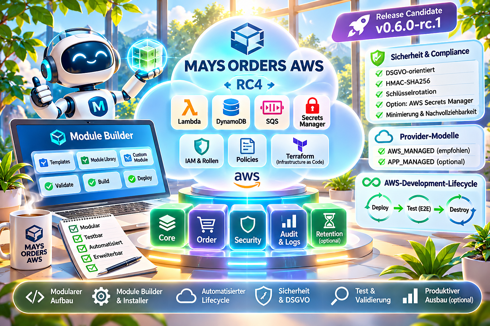
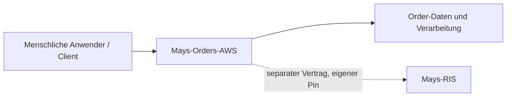

# Mays-Orders-AWS Wiki

> **Eine verständliche Karte durch Produkt, Bedienung und Technik.**
> Stand: 25. November 2026 · dokumentierte Basis: `main` `543ef75` · Wiki ist
> Teil des Repositorys und wird mit dem Dokumentations-Checkpoint gepflegt.

Mays-Orders-AWS ist ein modulares AWS-Projekt: Es enthält einen Order-Service,
wiederverwendbare Terraform-Bausteine, einen Module Builder und einen Installer
mit Schutzprüfungen. Diese Wiki erklärt, wofür die Teile da sind, wie sie
zusammenspielen und wo der belegte Entwicklungsstand endet.

## Auf einen Blick

| Baustein | Rolle | Reifegrad |
|---|---|---|
| Order-Service | API, Statusmaschine, Persistenz, SQS/Worker | lokal und im isolierten AWS-Development-Zyklus verifiziert |
| Terraform | 7 Child-Module + Root + Policy Gate | `validate`/Plan-Nachweise; Produktion nicht freigegeben |
| Module Builder | erzeugt eigenständige Terraform-Projekte | 129/129 Tests; Presets `complete` und `orders-service` |
| Installer | Kontext-/Plan-/State-/Artefakt-Schutz um Terraform | 674 release-weite Tests, 81 fokussiert; Mutationen nur mit Freigabe |
| Privacy | Inspect/Export/Erase/Anonymize im Code | interne Funktion; produktive Aktivierung BLOCKED |

## Neu seit dem RC4-Tag

- **`orderDescription` (F012):** optionales Freitextfeld, in `main` integriert,
  getestet und dokumentiert — **nicht deployed**.
- **SKU-Empfehlung:** `items[].sku` ist frei/nicht kataloggeprüft; eigene
  Konventionen als informative Order-Art-Markierung sind dokumentiert, aber
  **kein** Routing-Ersatz für `orderType` (`api/endpoints.md` §2.1.1).
- **Dokumentations-Konsistenz:** Status, Test-Ergebnisse, API-Testfälle,
  Roadmap, Schema und Auditlog wurden nachgezogen.
- **RIS-Integrationsreferenz:** Die separate synthetische RIS-Abnahme ist in
  einem kurzen Bericht verlinkt; sie ist weder Mays-Orders-Release noch Privacy-
  Freigabe für echte personenbezogene Daten ([Referenz](../reports/RIS-MAYS-ORDERS-INTEGRATION-REFERENCE-01.md)).

## Schnell zum passenden Einstieg

| Wenn du … | Beginne hier |
|---|---|
| das Projekt zum ersten Mal siehst | [Produkt und Rollen](01-produkt-und-rollen.md) |
| verstehen willst, wie eine Bestellung durch das System läuft | [Architektur](02-architektur.md) und [Order-Lebenszyklus](03-orders-und-api.md) |
| Module zu einem eigenen Terraform-Projekt zusammensetzen willst | [Module Builder](04-module-builder.md) |
| Installation oder Rückbau kontrolliert ausführen willst | [Installer-Handbuch](05-installer.md) |
| Security, Datenschutz und Freigaben einordnen willst | [Sicherheit und Datenschutz](06-sicherheit-und-datenschutz.md) |
| Releases, Tests oder Betrieb nachschlagen willst | [Betrieb und Release-Stand](07-betrieb-und-release.md) |
| Code beitragen oder Tests nachvollziehen willst | [Entwicklung und Qualität](08-entwicklung-und-qualitaet.md) |
| wissen willst, wie das Projekt gewachsen ist | [Entwicklungschronik](09-entwicklungschronik.md) |
| Abkürzungen oder Begriffe suchst | [Glossar](10-glossar.md) |
| die kanonischen Detaildokumente suchst | [Dokumentationsportal](11-dokumentationsportal.md) |
| eine schnelle Erklärung ohne Technik-Jargon suchst | [FAQ](12-faq.md) |

## In einem Satz

Ein authentifizierter Aufruf erreicht über Cognito-JWT und API Gateway eine
Python-Lambda; die Order-Domain prüft Berechtigung und Statusregeln, speichert in
DynamoDB und kann Arbeit über SQS an einen Worker übergeben. Terraform baut die
Infrastruktur, der Builder erzeugt daraus eigenständige Projekte, und der
Installer führt den Infrastruktur-Lebenszyklus mit mehreren Prüfschritten.

## Aktueller Stand — bitte vor Nutzung beachten

- Der aktuelle Release-Kandidat ist **`v0.6.0-rc.1`** (Tag `5bc154e`). Er ist als
  GitHub-Pre-Release veröffentlicht; er ist **kein Produktionsrollout**.
- Der dokumentierte AWS-Development-Zyklus wurde erstellt, live geprüft und
  wieder entfernt: 58 Ressourcen angelegt, 4/4 Live-E2E-Prüfungen bestanden,
  58 Ressourcen zerstört, Terraform-State anschließend leer.
- **Es gab kein Produktionsdeployment.** Privacy-/Retention-Aktivierung ist
  nicht für Produktion freigegeben; automatische Aufbewahrung ist absichtlich
  deaktiviert, bis die fachlichen Fristen entschieden sind.
- Das optionale Feld `orderDescription` (F012) wurde nach dem RC4-Tag in `main`
  integriert, aber **nicht deployed**; Clients sollen es nicht als live
  voraussetzen.
- Die CI/CD-Pipeline `mays-orders-development-ci-cd` hat weiterhin einen
  **Source-Fail** (fehlender Artefakt-Bucket); es laufen dadurch keine
  Build-/Plan-/Deploy-Stages. Die Legacy-Pipeline `directAWSGit` ist nicht
  push-getriggert.
- Mays-Orders-AWS und Mays-RIS sind getrennte Produkte. Ein Release oder Tag in
  diesem Repository aktualisiert RIS nicht automatisch; der RIS-Pin bleibt laut
  Release Notes `1dbb0cb` (RC3).

Die Angaben oben beruhen auf `docs/PROJECT_STATUS.md`, `docs/RELEASE_NOTES.md`,
`docs/roadmap/ROADMAP.md` und den jeweils verlinkten Nachweisen. Statuswerte
beschreiben den Belegstand, nicht eine pauschale Produktionsfreigabe.

## Die zentrale Systemgrenze

Der Builder kopiert Module, Richtlinien und gebaute Artefakte in ein Zielprojekt.
Das Zielprojekt benötigt das Quellrepository nicht zur Laufzeit. Der Installer
ist eine Bedien- und Sicherheits-/Kontextschicht über Terraform, kein Ersatz für
Terraform, IAM, organisatorische Freigaben oder eine Betriebsorganisation.

## Verzeichnis der Wiki-Seiten

- [01 · Produkt und Rollen](01-produkt-und-rollen.md)
- [02 · Architektur](02-architektur.md)
- [03 · Orders und API](03-orders-und-api.md)
- [04 · Module Builder](04-module-builder.md)
- [05 · Installer](05-installer.md)
- [06 · Sicherheit und Datenschutz](06-sicherheit-und-datenschutz.md)
- [07 · Betrieb und Release](07-betrieb-und-release.md)
- [08 · Entwicklung und Qualität](08-entwicklung-und-qualitaet.md)
- [09 · Entwicklungschronik](09-entwicklungschronik.md)
- [10 · Glossar](10-glossar.md)
- [11 · Dokumentationsportal](11-dokumentationsportal.md)
- [12 · FAQ](12-faq.md)
- [Quellen und Pflege](QUELLEN.md)

## Bilder und Diagramme

- Titelbild: `docs/assets/mays-orders-aws-rc4-hero.png` aus dem RC4-Release.
- Architektur: Mermaid-Quellen in den Seiten; das frühe SVG
  `architecture/architecture-diagram.svg` wird in [Architektur](02-architektur.md)
  mit Stand-Hinweis eingebunden.
- Chronik: historische Release-Grafik aus `docs/release/img/` mit klarer
  Datums-/Statuskennzeichnung.

## Pflege dieser Wiki

Diese Wiki liegt unter `docs/wiki/` und ist Teil des Repositorys. Bei Änderungen
an API, Architektur, Status, Release, Tests, Installer oder Module Builder:

1. die betroffene Wiki-Seite aktualisieren,
2. `README.md` (Status/Neuigkeiten) und `QUELLEN.md` (Basis/Datum) prüfen,
3. Links und Bilder lokal kontrollieren,
4. den normalen Dokumentations-Checkpoint ausführen
   (`git diff --check`, Secret-Audit, Commit, Push).

Keine Pass-/Verified-Aussage ohne Evidence-Pfad; historische Berichte bleiben
historisch und werden nicht rückwirkend umgeschrieben.
